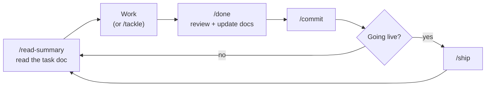

# Getting started with syafiqkit

A one-page guide for your first week. The full skill list is in the [README](../README.md); you don't need it yet.

## 1. Install it (about 5 minutes) {#install}

```bash
claude plugin marketplace add https://github.com/syafiq555/syafiqkit
claude plugin install syafiqkit@syafiqkit
```

If your project has no agents of its own yet, also install the two helpers `/done` falls back on:

```bash
claude plugin install code-simplifier@claude-plugins-official
claude plugin install feature-dev@claude-plugins-official
```

Start a new Claude Code session. Skills are typed as `/syafiqkit:<name>`, or just `/<name>` when no other plugin uses that name (this guide uses the short form).

Update every so often with `claude plugin update syafiqkit@syafiqkit`.

## 2. What changes as soon as it's installed {#what-changes}

- **Claude answers differently.** Replies lead with the thing to do, steps come numbered, estimates use real units ("about 15 minutes"), and filler openers and closers are gone. This is on for every session; the rules are in `hooks/RULESET.md`.
- **A line appears above your prompt** (Claude Code 2.1.287 or later): `e: enhance  d: docs  g: changes │ w: done › c: commit › p: push › s: ship`. The four chips on the right show how far your wrap-up has got (grey not yet, blue running, green done). Press a letter to run that step; push and ship ask before acting.
- **`/sk` opens a one-key menu** for the common jobs (commit, done, ship, read a doc).

## 3. The idea behind it: task docs {#task-docs}

Code shows *what* the system does. It doesn't show *why*, what was tried and rejected, or what bites. syafiqkit keeps that in **task docs**:

```
tasks/<area>/current.md          ← the summary: status, quick start, gotchas
tasks/<area>/decisions/*.md      ← the longer reasoning, one theme per file
```

Almost every skill reads these before acting and updates them after. That is what lets a fresh session (or a new teammate) pick up work without you re-explaining it.

New repo with no docs yet? Run `/setup-project-docs` once, then `/agent-setup` to create the project's reviewer and builder agents.

## 4. Your daily loop {#daily-loop}

1. **Start:** `/read-summary <area or question>`. Claude finds the right task doc and reads it before touching anything. Example: `/read-summary why do refunds skip the ledger?`
2. **Work:** ask for what you need in plain words. If you only know "carry on from the doc", use `/tackle`.
3. **Wrap up:** `/done`. It tidies the code, runs a review, and writes what you learned into the task doc and CLAUDE.md. For a tiny change, `/quick-done` does just the doc update.
4. **Save:** `/commit` (or `/commit push`).
5. **Release** (when it should go live): `/ship`. It commits, writes the changelog, pushes, checks CI and drafts the release note.

Running out of context mid-task? `/continue-session` gives you a prompt to paste into a fresh session.

## 5. The ten skills worth learning first {#first-ten}

| You want to | Type |
|---|---|
| Get context before a question or a build | `/read-summary` |
| Finish a piece of work properly | `/done` (small: `/quick-done`) |
| Commit, or commit and push | `/commit`, `/commit push` |
| Release to production | `/ship` |
| Hand work to a new session | `/continue-session` |
| Write or update a task doc by hand | `/task-summary` |
| Make a screen look or work better | `/uiux` |
| Write a message in your own voice | `/casual-message` |
| Post a release note or update to Google Chat | `/gchat-format` |
| A doc got too long | `/condense-task-doc` or `/condense-claude-md` |

You don't always need to type the name: most skills fire on their own when you describe the job ("wrap up", "ship it", "this page looks off").

## 6. Optional: connect Google and your servers {#tools}

Say "set up the Google Sheets / Google Chat / remote tool for me". `/setup-tools` walks you through your own Google Cloud project and sign-in, and checks it works with a real read. Sending a Chat message or email always stops at Claude Code's permission prompt for you to approve.

## 7. When something goes wrong {#troubleshooting}

- **A skill didn't fire, or did the wrong thing:** say so, then run `/update-plugin` at the end of the session. It patches the skill so the next person doesn't hit it.
- **Answers feel too terse or too long:** tell Claude in plain words; your stated preference wins over the default style.
- **The line above the prompt is missing:** check your Claude Code version (2.1.287+). It never shows in the VS Code panel or `claude -p`. Set `SYAFIQKIT_MOD=0` before starting Claude Code to turn it off.
- **You want it gone:** `claude plugin uninstall syafiqkit@syafiqkit`.

## The loop at a glance {#loop-diagram}


