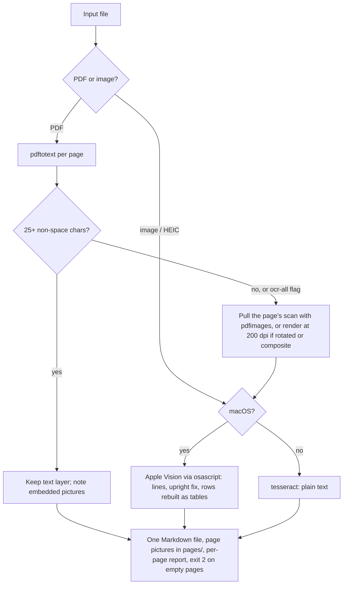

<!--LLM-CONTEXT
Status: 🚀 Apple Vision OCR built, reviewed, scored 19/20; ready to commit
Domain: plugin-maintenance / doc-to-md
Gotchas (critical; full list in ## Gotchas below):
  - Apple Vision can drop a lone single character (a quantity of 1 in a table cell); quoted figures are checked against the page picture
  - Vision reports box positions in the image's frame even for sideways text; reading direction comes from first/last character boxes (vision_ocr.js dx, dy)
Related: tasks/plugin-maintenance/motion-clip/current.md (store check now OCRs captured screens)
Last updated: 2026-11-26
-->

# syafiqkit: doc-to-md OCR for scans, photos and screenshots

## Quick Start (read this first in next session)

**Where we are**: `doc-to-md` reads scanned PDF pages and images through Apple Vision (macOS built-in, via `osascript`), tesseract elsewhere. Built and tested on an Apple M4 on 26/11/2026 as 1.478.0. Score loop ended at round 2 (both judges 19/20, stop rule 18/20).

**Immediate next actions (in order)**:
1. Commit only this session's paths and hunks (peer sessions share the checkout), push to `master`, then `claude plugin update syafiqkit@syafiqkit`.

**Blocked**: nothing blocked.

**Key facts for cold start**:
- Test: `python3 -I skills/doc-to-md/scripts/ocr_to_md.py <mixed.pdf> /tmp/out.md`. Success: one stderr line per page naming its engine, an invoice page as a pipe table, `pages/<copy name>-p<N>.jpg` linked under each OCR'd page marker, exit 0.
- `EMPTY pages ...` exits 2; `LITTLE TEXT on pages ...`, `embedded picture(s) not read` and `full-page picture under the text on pages ...` are notes (exit 0).
- The local plugin cache does not re-copy at an unchanged version; to test uncommitted skill files in a headless session, rsync them into `~/.claude/plugins/cache/syafiqkit/syafiqkit/<version>/`.

---

## Overview

Before 1.478.0, `doc-to-md` converted PDFs with `pdftotext` only, so a scanned PDF came out as an empty Markdown file that still passed the page-count check. Images were read only by Claude looking at them, which left nothing to grep or diff. The OCR path fills both gaps with nothing to install on a Mac and nothing uploaded.

## Files

- `skills/doc-to-md/scripts/ocr_to_md.py`: stdlib orchestrator. Routes each page, extracts or renders scans, calls Vision or tesseract, rebuilds rows and tables from word boxes, writes the Markdown and the `pages/` pictures, reports per page.
- `skills/doc-to-md/scripts/vision_ocr.js`: JXA script run by `osascript -l JavaScript`; `VNRecognizeTextRequest` (accurate, language correction on) per image, prints text, box, and first-to-last character offsets as TSV.
- Callers: `skills/read-summary/SKILL.md` (Reading Order, decisions bullet: a scanned or photographed document the work rests on goes through doc-to-md first; a glance at one screenshot does not), `skills/sign-pdf/SKILL.md` (scanned form wording), `skills/motion-clip/references/store-presets.md` (prices and dates in captured screens).

## Key Technical Decisions

### D-ocr-engine: Apple Vision, tesseract on Linux [committed] · 2026-11-26

**Problem**
Scanned pages produced silent empty copies. Syafiq asked to research "Baidu China unlimited OCR open source" and build it into the kit.

**Decision**
Chosen: Apple Vision through `osascript`, tesseract where macOS is absent (Syafiq, after seeing PaddleOCR-VL's memory use: "i think we cannot use this too heavy for normal laptop").
- Nothing to install for images (PDFs need poppler, which the old converter already needed), 80 to 90 MB of memory.
- On a realistic scan it read the contract page word-perfect; tesseract made one slip (`SS2` as `$$2`).

**Rejected**
- PaddleOCR-VL 1.6, full (Baidu, Apache-2.0; first built and shipped to review). Why not: 7 to 9 GB of memory per run measured on an M4; two runs at once pushed a 24 GB Mac to under 1 GB of free swap. Better at tables, formulas, charts and figure crops.
- PaddleOCR-VL 1.6, 4-bit MLX (`mlx-community/PaddleOCR-VL-1.6-4bit` via `mlx_vlm.generate`, prompt `OCR:`). Why not: 2.7 GB peak and a ~1.6 GB install for every user, Apple Silicon only; ~7 s a page; table rows kept as spaced text. Offered as an opt-in; Syafiq chose Vision only.
- PP-OCRv5 mobile (Baidu's small classic OCR). Why not: 1.7 GB of memory and worse reading than Vision on the same page.
- Baidu Unlimited-OCR 2 (3B, MIT, 27/10/2026, the "unlimited" in the request: one-pass parsing of 100 to 300 page documents). Why not: CUDA or a custom SGLang wheel only.
- Baidu hosted API (AI Studio, 3,000 pages per model per day free). Why not: uploads client files to servers in China.

**Consequences**
- No headings, formulas or chart data; diagrams, charts and stamps are read by Claude from the saved page picture.
- Linux colleagues get plain tesseract text with no table rebuild.

**Status**: committed · **Reversible**: yes (the Paddle build is described above; its scripts were deleted, not committed)

| Decision | Rationale |
|----------|-----------|
| OCR lives inside `doc-to-md`, not a new skill | Syafiq's pick: no extra skill to route between |
| Vision through JXA (`osascript`), not a compiled Swift helper | `swiftc` needs Xcode command-line tools, which colleagues may lack; `osascript` ships with every Mac |
| Save every OCR'd page as a JPEG in `pages/` | Syafiq asked how diagrams, architecture drawings and symbols are handled; Vision only reads their labels, so Claude needs the picture |
| Tables rebuilt from word boxes (2+ consecutive multi-cell rows, columns clustered within 0.04 of page width) | Vision returns lines, not tables; the invoice test came back as a correct pipe table |
| Reading direction from first/last character centres, majority across the page | Vision reads sideways and upside-down text correctly but reports boxes in the image's frame; turning the image and keeping the reading with more text could not tell up from down |
| A page read sideways is re-OCR'd on a `sips`-rotated copy, the second pass forced upright, and that copy saved as the page picture | Vision read vertical text with losses (item 1 dropped, item 2 garbled on a 90-degree page); upright it read every line |
| Tilt removed by shearing rows by the median first-to-last-character slope; line heights shrunk by abs(slope) times line length | A 2-degree tilt scattered table cells across lines; tilted line boxes are taller than the lines, which merged neighbouring lines on a 3-degree page. 2, 3 and 4 degrees now read clean |
| Cyrillic and Greek look-alikes mapped to Latin only inside tokens made entirely of look-alike or ASCII letters, on Latin-dominant pages | Vision wrote "API" as Cyrillic "АРІ", so a search for `API` missed it; a per-character map also turned real names (Москва, Ελλάδα) into hybrids |
| Vision languages default `en-US,ms-MY` (`--vision-lang`) | A Malay contract page read word-perfect; English output unchanged |
| An all-typed PDF writes `pdftotext -layout` of the whole document, byte for byte (form feeds, no page markers) | Copies already kept in git under the old converter regenerate with no false diff |
| Full-page pictures under a text layer (searchable scans) get one summary note; partial pictures get the per-page note | The per-page note fired on every page of a searchable scan, which trains readers to ignore it; a full-page pasted screenshot still needs a mention |
| `pdfimages` extraction only when the page's images are one `image` row plus optional `smask` rows | A stencil or mask-layered scan keeps its text in another row, so extracting the lone image would read a blank background |
| `pdfimages` extraction for an unrotated page with one scan picture ≥1000 px wide, else `pdftoppm -r 200` | Render cost 5.3 s a page on the test scans; extraction 1.2 s. Rotated pages need the render, which applies the rotation |
| OCR at 200 dpi, not 150 | 150 dpi saved time but dropped more single digits in the invoice's Qty column |
| `read-summary` routes source PDFs and images to doc-to-md | Syafiq asked mid-build that read-summary know when doc-to-md applies |

## Measurements (Apple M4, 24 GB, 26/11/2026)

| Engine | Peak memory | Per page | Realistic scan | Invoice table |
|---|---|---|---|---|
| PaddleOCR-VL full, CPU | 7.3 to 9.3 GB | 15 to 45 s | word-perfect | pipe table |
| PaddleOCR-VL 4-bit MLX | 2.7 GB footprint | ~7 s | word-perfect | rows as spaced text |
| PP-OCRv5 mobile | 1.7 GB | ~4.5 s | poor on noisy page | items out of order |
| Apple Vision (shipped) | 80 to 90 MB | 0.25 s for the Vision call alone | word-perfect | pipe table, lone `1`s sometimes dropped |
| tesseract | 75 MB | 0.2 s | one slip | garbled |

Whole script, measured with other sessions running (load average about 12), two runs each: a photo 0.7 s; a 3-page scanned PDF 6.9 s (about 2.3 s a page, mostly extraction and picture saving); the same pages rotated 90 degrees 21 to 23 s (about 7 s a page, rendered and read twice); first call after a restart up to 30 s extra. A Malay contract page and 2 to 4 degree tilts read word-perfect.

## Score loop (frozen 26/11/2026, re-frozen for the Vision design before any round was scored)

Stop rule (Syafiq): 18/20 or 3 rounds, whichever first. Ten criteria, each 2 = fully meets, 1 = meets with a visible gap, 0 = missing or broken, or "cannot assess" (scores 0, named).

| # | Criterion | Measured by |
|---|---|---|
| 1 | A scanned PDF becomes a non-empty, correct Markdown copy | Run `ocr_to_md.py` on a 3-page scan, compare words to the page images |
| 2 | A mixed PDF: typed pages keep their text layer, scanned pages are OCR'd; an all-typed PDF converts as before | Run on a mixed PDF and a typed-only PDF |
| 3 | Tables come out as Markdown pipe tables on a Mac | Run on the invoice page |
| 4 | Visuals: each OCR'd page has a linked page picture, SKILL.md tells Claude to open and describe diagrams from it, a typed page carrying a picture is flagged, a sideways page is read upright | Run on the diagram page, a typed PDF with an embedded picture, a rotated page |
| 5 | No silent failure: empty pages exit 2 with a message; low-text pages are flagged; tool errors give a message, not a traceback | Blank page, missing file, unsupported type |
| 6 | Light: nothing to install on a Mac, memory under 200 MB, works on Linux via tesseract | `/usr/bin/time -l`; read the engine selection |
| 7 | Routing: the doc-to-md description and read-summary's sentence send scanned documents and photos of documents to doc-to-md, without routing every glance at a screenshot | Fresh headless sessions given the user's words, read from their tool calls |
| 8 | Portable for colleagues: no author-machine paths, platform limits stated, every command path resolves from where it is read | Grep added lines; `ls` each relative path from its file |
| 9 | Honest about accuracy and cost: OCR error caveat, measured speed and memory, engine named per page, no unmeasured claims | Read SKILL.md and CHANGELOG against the measurements above |
| 10 | House style and release: no explanatory code comments, no em dashes in added lines, manifests match and sit above the pushed version, CHANGELOG states the reader's action | Grep, `git show origin/master:.claude-plugin/plugin.json` |

Not defects (conventions): no headings, formulas or chart data (decided with the engine); Linux gets plain tesseract text; Malay accuracy untested; peer sessions' hunks in shared files; synthetic test pages.

| Round | Score | Judge |
|---|---|---|
| 1 | 17/20 | fresh (rotated page lost a line; "nothing to install" overstated for PDFs) |
| 2 | 19/20 (was 17, 2 closed) · 19/20 | retained · fresh; both met the stop rule, loop ended. Both docked speed claims, since restated from re-measurement |

Headless checks, fresh `claude -p` sessions given the user's words:
- "convert this scanned pdf to md: <scan>. what does the architecture diagram on the last page show?" loaded `doc-to-md`, ran `ocr_to_md.py`, opened the page pictures, described the diagram correctly (Mobile App, API Gateway, Database, Payment Queue; no arrows) and filled the dropped digits from the pictures.
- "/syafiqkit:read-summary what does the invoice in <png> say the total is" read the one image by eye and cross-checked the line items: the glance case the read-summary sentence exempts.

## Gotchas

| Symptom | Cause | Fix |
|---|---|---|
| Sideways or upside-down page reads with lines in reverse order | Vision returns boxes in the image frame; sorting by y alone flips the order | `upright()` maps boxes using the page's majority first-to-last character direction |
| Empty Qty cells where the page shows `1` | Vision drops some lone single characters | Documented; read from the page picture |
| A two-column prose page becomes a two-column table | Rows are rebuilt from positions, so side-by-side lines share a row | Documented in SKILL.md gotchas |
| A reviewer reports tesseract "image file not found" on a `/tmp` path | Agent sandboxes block tesseract's read there; the main session reads the same file | Not a defect; check in the main session |
| `claude -p ... --allowedTools "A B" "<prompt>"` runs with no prompt | `--allowedTools` swallowed the prompt as a value | Put the prompt right after `-p` |
| Two PaddleOCR runs at once froze a 24 GB Mac into swap (historical, Paddle removed) | 7 to 9 GB each | Why the engine is Vision |

## Next Steps

### Blocking the release
- [ ] 🔴 Commit this session's paths and hunks, push to `master`, plugin update

### Deferred / accepted
- [ ] 🟡 Re-measure speed on an idle machine; the stated ranges were taken at load average about 12
- [ ] 🟡 Opt-in 4-bit PaddleOCR-VL for table-heavy or poor scans, if users ask (2.7 GB, Apple Silicon)
