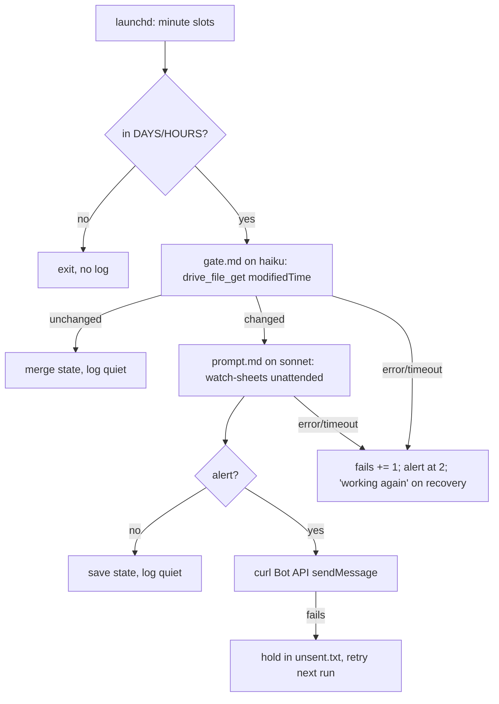

<!--LLM-CONTEXT
Status: 🚀 Built and live on one job (CRP45 sheets)
Domain: plugin-maintenance / headless-watch
Gotchas (critical; full list in ## Critical Gotchas below):
  - Never `--channels` on a scheduled run: the Telegram plugin kills the existing poller on load
  - The installed copy at ~/.claude/watchers/bin/watcher.sh only changes on `install`
Related: skills/watch-sheets/SKILL.md (its "Unattended run" paragraph), ~/.claude/.claude-companions/shared/CLAUDE-headless.md#phone-channel
Last updated: 2026-11-18
-->

# syafiqkit: headless-watch Summary

## Quick Start (read this first in next session)

**Where we are**: `headless-watch` (1.456.0) runs read-only checks from launchd with Claude closed. The first job, `crp45-sheets`, has run cleanly since 18/11/2026 16:21.

**Immediate next actions (in order)**:
1. Read `~/.claude/watchers/crp45-sheets/run.log` after a working day: count full runs against gate runs, and check that alerts matched rows that really were our turn.
2. If full runs fire on edits that never need us (many `quiet ($0.5…)` lines), make `gate.md` compare something narrower than `modifiedTime`.

**Key facts for cold start**:
- Live job: `bash ~/.claude/watchers/bin/watcher.sh status crp45-sheets`; stop with `... uninstall crp45-sheets`.
- Test without waiting for the schedule: `run <name> --now` (shell) or `kick <name>` (launchd context).
- Success looks like: one "Watching today" Telegram message each work-day morning, `quiet (gate, $0.017)` lines, and an `ALERT sent` line only for rows that are our turn.

**Gotchas that will trip you**:
- A fix to `scripts/watcher.sh` reaches a running job only after `install` copies it again.
- A `run` outside `DAYS`/`HOURS` exits silently from launchd (prints a hint only on a terminal).

---

## Overview

A scheduled `claude -p` from cron fails silently in four ways: no PATH to `claude` or MCP runtimes, exit 0 on a failed login, no memory between runs (so a conversation-baseline skill alerts every time), and silence that can't tell healthy from broken. `headless-watch` is one script plus a skill that sets up a job per check and proves it end to end. Built 18/11/2026 from Syafiq's crontab idea for the CRP45 sheets, generalised at his request ("make it as general").

---

## Architecture / Data Model

| Field | Value | Notes |
|-------|-------|-------|
| Job folder | `~/.claude/watchers/<name>/` (0700) | `job.env`, `prompt.md`, optional `gate.md`, `state.json`, `run.log`, `fails`, `heartbeat`, `unsent.txt` |
| Verdict | `--json-schema` → `structured_output` | gate `{changed, state}`, main `{alert, message, state}`; `structured_output` field verified 18/11 on 2.1.327 |
| Flags | `--permission-mode default --permission-prompts none --allowedTools=… --max-budget-usd --no-session-persistence` | prompt piped on stdin (avoids the variadic `--allowedTools` swallowing args) |
| Schedule | `StartCalendarInterval` minute dicts when interval divides 60, else `StartInterval` | calendar jobs run once on wake (launchd.plist(5)); StartInterval drops sleep-time runs |
| Run limit | `RUN_TIMEOUT_MIN` (15) watchdog kills claude | marks `.timedout`, counts as a failure |
| Gate state | `jq -s '.[0] * .[1].structured_output.state'` | merged, so a gate can't drop keys only the full run writes |

---

## Files

- `skills/headless-watch/SKILL.md`: when to use, setup steps 0 to 6, managing jobs, limits.
- `skills/headless-watch/scripts/watcher.sh`: `run [--now]`, `install`, `uninstall`, `kick`, `test-alert`, `status`.
- `skills/watch-sheets/SKILL.md`: "Unattended run" paragraph (state holds ids, statuses, counts, dates; never text or names) and the session-vs-closed fork in Setup.

---

## Key Technical Decisions

### D-send-not-channels: alert by Bot API sendMessage, not `--channels` [committed] · 2026-11-18

**Problem**
Syafiq's crontab line expected `--channels` for Telegram.

**Decision**
Chosen: the script sends with curl `sendMessage`, token read at send time from `~/.claude/channels/telegram/.env` and passed on stdin.
- The plugin kills the existing getUpdates poller when a session loads it (`server.ts:58-73`), so a 10-minute job would knock the `claudetelegram` session off each run, and the `-p` session exits so replies go nowhere.
- `sendMessage` doesn't poll, so it disturbs nothing.

**Rejected**
- `--channels` per run. Why not: steals the bot, and is one-way anyway.

**Consequences**
Alerts are one-way. Answering happens in an interactive session.

**Status**: committed · **Reversible**: yes

| Decision | Rationale |
|----------|-----------|
| Model returns a verdict; script sends | The model never holds the token or a send tool, so allowed tools stay read-only |
| launchd, not cron | cron skips runs during sleep and has no profile PATH |
| `install` copies the script to `~/.claude/watchers/bin/` | the plugin cache version folder is pruned 7 days after the next update |
| Failure alert at the 2nd failure in a row, plus a daily heartbeat | one transient blip stays quiet; a missing heartbeat catches a dead alert route, which can't report itself |
| No text dedup in the script | the skill's state already keeps a raised row quiet until it moves; a text match swallowed a client's second reply worded the same (review 18/11) |
| Failure alerts carry a short reason, details stay in `run.log` | a claude error result can quote sheet text, and the alert goes to a third-party chat |
| `install` refreshes the copy only when run from the plugin copy, and says so | the installed copy can't know where the plugin lives; it prints "not refreshed" instead of silently keeping old code |

---

## Critical Gotchas

### Running and testing
| Issue | Rule |
|-------|------|
| `run` outside the window does nothing | use `run <name> --now`; `kick` writes `.force` so the launchd run ignores the window too |
| First full run with empty state can alert | `watch-sheets` raises what is our turn as it stands; say so before the first run |
| `permission_denials` in `.main.json` | a tool is missing from `ALLOWED_TOOLS`; a prompt that invokes a skill needs `Skill` |
| A pasted crontab line left installed | runs beside the job with no state or failure alert; `uninstall` won't stop it |

---

## Last Session

- Built the skill, the runner and the `watch-sheets` unattended mode; installed `crp45-sheets` (Telegram chat 246191042, weekdays 9 to 19, every 10 minutes).
- Measured: gate run $0.017, full sonnet `watch-sheets` run $0.52 (16 turns), haiku hello run $0.007.
- Three review rounds added: the run time limit, `--now`/`.force`, the gate state merge, script dedup removed, short failure text, `install` refresh messages, the crontab-paste step, the stop line, `job.env.example`, and the `watch-sheets` stop path checking background jobs.

---

## Next Steps

### Missing failure signals
- [ ] 🟠 Keychain login under launchd with the screen locked is unverified; if a locked-screen run fails, move the job to a `claude setup-token` token (`claude-server-token`).

### Deferred / accepted
- [ ] 🟡 First full run did not alert on Tracker row 60 (Pending TSB), recorded as parked until after go-live; confirm with Syafiq whether parked Pending TSB rows should alert.
- [ ] 🟡 Linux support (systemd timer) only if a colleague asks; only `install`/`uninstall` are launchd-specific.
