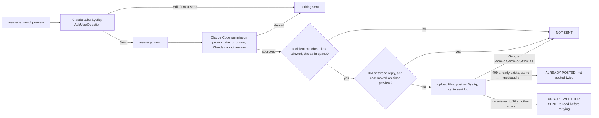

<!--LLM-CONTEXT
Status: ✅ Live (user scope, work account): read, search and send checked on real chats 13/11/2026; 1.430 adds attachments, the phone-friendly send gate, timeouts, a duplicate-send guard and a 1000-character cap, not yet seen live
Domain: tools / gchat-mcp
Gotchas: the send gate is Claude Code's permission prompt forced by `_meta["anthropic/requiresUserInteraction"]`, never a code the model can read; MCP elicitation hung over Remote Control (../../CLAUDE.md)
Related: ../../README.md, ../../CLAUDE.md, ../../../gsheets-mcp/tasks/server/current.md, ~/.claude/references/google-sheets-access.md
Last updated: 2026-11-13: review fixes (timeouts, client messageId, 1000-char cap, refusal wording, download cleanup, wider secret-file list)
-->

# gchat-mcp: the server

## Quick Start (read this first in next session)

**Next action**: the live check after `/mcp reconnect gchat` (Next Steps, first item).
**Blocked on**: nothing.
**Current state**: signed in (`~/.config/syafiqkit/google-chat/`), registered at user scope in `~/.claude.json`, Chat API, People API and Chat app configuration done in `careful-yew-506703-e8`. Run `cd tools/gchat-mcp && bun test` (49 pass on 13/11) and `bunx tsc --noEmit`. A running Claude session keeps the old server until `/mcp reconnect gchat`.
**Next check, live**: one `attachment_download` of a real screenshot, one send with a file approved from the phone, and confirm Google accepts the `client-` messageId (a 400 on every send would mean it doesn't).
**Success looks like**: in any repo, "what did Hong Liang say in the Autorentic space this week" answers from real messages including posted screenshots, and a send asks Syafiq first (AskUserQuestion), then posts only after he taps Claude Code's permission prompt, on the Mac or the phone.

## Overview

Google Chat as the signed-in user: list spaces and DMs, read one, search across them, download a message's attached files, and send (with files) behind Claude Code's permission prompt. Setup and tools are in `../../README.md`; why it is built this way is in `../../CLAUDE.md`.

## Checked live (13/11/2026, through the stdio server)

| Check | Result |
|---|---|
| `spaces_list` | Spaces and DMs newest first; DMs named after the other person once own-id came from shared DM members (first try listed you in every DM, see CLAUDE.md) |
| `messages_list` on the Hong Liang DM, by person name | Resolved "Hong Liang" to the DM; latest 5 in order, your line tagged "(you)"; uppercase `orderBy` accepted |
| `messages_search` "staging", 3 days, 8 spaces | Hits grouped by space (CRP45 space: 6) |
| `message_send` to the Man Hou DM | The dialog showed recipient and text; Accept posted it (18:51). Three earlier tries with a tick box on top of Accept all went unsent, so the box was removed (see CLAUDE.md). A second send at 18:54 also posted |
| How the recipient sees it | Google showed "You · Claude Chat Reader" beside the message; the app was renamed "Syafiq" in the Chat API Configuration page the same evening (whether existing messages pick up the new name is unconfirmed) |
| Elicitation over Remote Control | Driven from the Claude phone app, `message_send`'s Accept dialog never appeared and the call hung until interrupted (twice, 13/11/2026 ~19:40). Replaced by the permission-prompt gate |
| Not yet seen live | `attachment_download`, sending files, the permission prompt on the phone, the `client-` messageId and Google's 409 wording for a duplicate: unit-tested only |

A first call before the Chat API was enabled answered 403 "Google Chat API has not been used in project 512973799395"; the tool adds the "enable that API" hint.

## Next Steps

- [ ] 🟠 Live check after `/mcp reconnect gchat`: download one of Hong Liang's 13/11 screenshots in SaaS-Autorentic (SCR-20261113-pspu.png), send the 13/11 Autorentic release note there through the new flow approving from the phone, and send one file to Syafiq's own DM. The release note is over 1000 characters, so it goes as several messages: check each reads well on the phone prompt.
- [ ] 🟡 Uploads use the whole `attachmentDataRef` in `messages.create`; Google's samples pass the upload response as is, but `resourceName` beside `attachmentUploadToken` is unconfirmed until the first live send with a file.
- [ ] 🟡 The ALREADY POSTED branch matches `409 … already exist`; Google's docs don't state the duplicate error, so record the real wording the first time it fires (until then a duplicate shows as UNSURE, which is the safe side).
- [ ] 🟡 Review leftovers, low: a timeout while reading a response body shows the raw "The operation timed out" (still classed UNSURE); `secrets*`/`credentials*`/`.key` also block innocent names like `secretariat.pdf` or a Keynote deck.

- [ ] Later, if asked: accept times like "18:48 today" in since/until
- [ ] Later, if asked: nicknames (`KL` → email), a never-read list of spaces, unread and @-mention views (need extra scopes)
