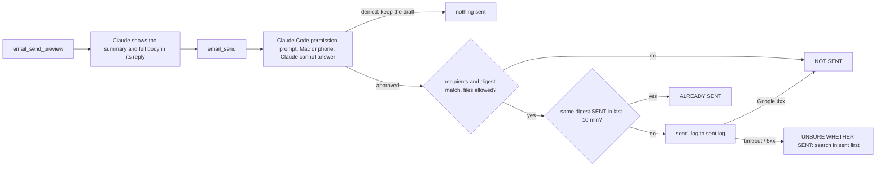

<!--LLM-CONTEXT
Status: built and unit-tested 19/11/2026, not yet signed in or seen live
Domain: tools / gmail-mcp
Gotchas: the send gate is Claude Code's permission prompt forced by `_meta["anthropic/requiresUserInteraction"]`; Gmail has no idempotency key, so the duplicate guard reads `sent.log`; `gmail.readonly` is a restricted scope, so use an Internal OAuth client (../../CLAUDE.md)
Related: ../../README.md, ../../CLAUDE.md, ../../../gchat-mcp/tasks/server/current.md
Last updated: 2026-11-19: first build
-->

# gmail-mcp: the server

## Quick Start (read this first in next session)

**Next action**: enable the Gmail API in the Cloud project, run `tools/gmail-mcp/bin/gmail-mcp auth` (a browser), `check --read`, then `bin/enable` and `/mcp reconnect gmail`.
**Blocked on**: the first sign-in (needs a browser and the Gmail API switched on).
**Current state**: `bun test` (76 pass) and `bunx tsc --noEmit` pass in `tools/gmail-mcp`; nothing has talked to Gmail yet. Mocked fetch only.

## Overview

Gmail as the signed-in user: search, read a message or thread, download attachments, and send (new or threaded reply, with files) behind Claude Code's permission prompt. Setup and tools are in `../../README.md`; why it is built this way is in `../../CLAUDE.md`.

## Next Steps

- [ ] 🟠 Live check after sign-in: `emails_search` and `email_read` on a real thread; `attachment_download` of one PDF; a send to Syafiq's own address approved from the phone; a threaded reply landing in the same conversation; a message over 4 MB (upload endpoint path, unit-tested only).
- [ ] 🟡 Confirm Google's wording for a 5xx and a timeout on `messages.send` the first time one occurs, and that the `fields` mask on `messages.get` returns nested parts as expected.
- [ ] 🟡 Add a Gmail case to the `setup-tools` skill (plugin root, not done here) and mention the tool in the plugin README and changelog.
- [ ] Later, if asked: forwarding with the original's attachments, drafts, labels.
