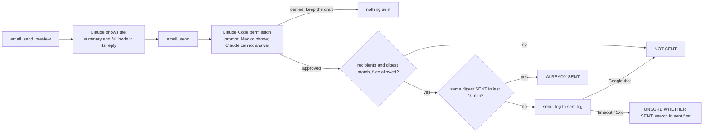

<!--LLM-CONTEXT
Status: live on the work account since 19/11/2026 (registered user-scope); four additions (replyMode, forward, enable [name], expired sign-in) built the same day, awaiting a live try
Domain: tools / gmail-mcp
Gotchas: the send gate is Claude Code's permission prompt forced by `_meta["anthropic/requiresUserInteraction"]`; Gmail has no idempotency key, so the duplicate guard reads `sent.log`; `gmail.readonly` is a restricted scope, so use an Internal OAuth client (../../CLAUDE.md)
Related: ../../README.md, ../../CLAUDE.md, ../../../gchat-mcp/tasks/server/current.md
Last updated: 2026-11-19: first live send; review fixes; four additions approved
-->

# gmail-mcp: the server

## Quick Start (read this first in next session)

**Next action**: `/mcp reconnect gmail`, then try the four additions live (see Next Steps).
**Blocked on**: nothing.
**Current state**: signed in as the work address (`~/.config/syafiqkit/google-gmail/`), registered as `gmail` at user scope; proven live 19/11 by a search, reading a forwarded thread and two threaded replies, one with a PDF, confirmed in Sent. Built 19/11 (Syafiq's four picks): `replyMode` `sender`/`all` on preview and send (addresses resolved in `compose`, own address removed, explicit `to`/`cc` merged, still checked by `recipients` and the digest); `forwardOf` (Fwd: subject, quoted header block and text, original attachments re-fetched through the API and hashed into the digest, not threaded, recipients never filled); `bin/enable [name]` for a second account with its own `GMAIL_CONFIG_DIR`; `invalid_grant` and 401 reported as an expired or revoked sign-in with the `auth` command, a send in that state staying NOT SENT. `bun test` (112 pass) and `tsc --noEmit` pass. Review fixes 19/11: parallel identical sends refused by an in-flight set, a 30 s token timeout, header folding, a wider attachment denylist (`.claude-companions/local/`, `wp-config*.php`, and others).

## Overview

Gmail as the signed-in user: search, read a message or thread, download attachments, and send (new or threaded reply, with files) behind Claude Code's permission prompt. Setup and tools are in `../../README.md`; why it is built this way is in `../../CLAUDE.md`.

## Next Steps

- [ ] 🟠 The four 19/11 additions are built and unit-tested but not yet seen live: a `replyMode` reply, a forward with an attachment, `bin/enable gmail-personal` against a real second account, and an expired sign-in message from Google.
- [ ] 🟡 Not yet seen live: an attachment download, a message over 4 MB (upload endpoint), a phone-approved send (what the phone prompt shows of the body), Google's wording for a 5xx or timeout, and that Gmail strips Bcc from delivered copies.
- [ ] 🟡 From the second product review (19/11), not yet decided: (a) aliases and send-as addresses aren't treated as you, so they land in a reply-all's Cc and the reply goes from the primary address; (b) a mailing list's Reply-To trips the redirect warning on every list reply (skip it when `List-Id` is present, or soften the wording); (c) two registered accounts get the same server instructions, so the model has nothing saying which mailbox is work and which personal (put the signed-in address in the instructions); (d) forwarding is one message only, inline images without a filename are dropped and HTML flattens to text, none of which the README says.
- [ ] 🟡 Known low risks left by the review: the HTML-to-text regex is quadratic on a hostile email with thousands of unclosed tags; a hard-linked secret file passes the denylist; downloads are pruned only at server start.
- [ ] Later, if asked: drafts, labels, HTML or a signature.
