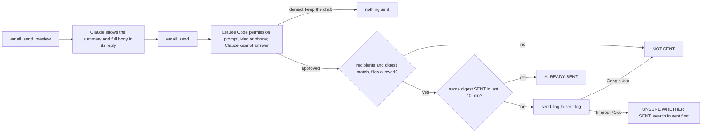

<!--LLM-CONTEXT
Status: live on the work account since 19/11/2026 (registered user-scope); four additions approved the same day, being built
Domain: tools / gmail-mcp
Gotchas: the send gate is Claude Code's permission prompt forced by `_meta["anthropic/requiresUserInteraction"]`; Gmail has no idempotency key, so the duplicate guard reads `sent.log`; `gmail.readonly` is a restricted scope, so use an Internal OAuth client (../../CLAUDE.md)
Related: ../../README.md, ../../CLAUDE.md, ../../../gchat-mcp/tasks/server/current.md
Last updated: 2026-11-19: first live send; review fixes; four additions approved
-->

# gmail-mcp: the server

## Quick Start (read this first in next session)

**Next action**: the four approved additions in Next Steps (Syafiq 19/11, all four picked from the product review).
**Blocked on**: nothing.
**Current state**: signed in as the work address (`~/.config/syafiqkit/google-gmail/`), registered as `gmail` at user scope; proven live 19/11 by a search, reading a forwarded thread and two threaded replies, one with a PDF, confirmed in Sent. `bun test` (78 pass) and `tsc --noEmit` pass. Review fixes 19/11: parallel identical sends refused by an in-flight set, a 30 s token timeout, header folding, a wider attachment denylist (`.claude-companions/local/`, `wp-config*.php`, and others).

## Overview

Gmail as the signed-in user: search, read a message or thread, download attachments, and send (new or threaded reply, with files) behind Claude Code's permission prompt. Setup and tools are in `../../README.md`; why it is built this way is in `../../CLAUDE.md`.

## Next Steps

- [ ] 🟠 Approved 19/11 (Syafiq picked all four from the product review):
  - Reply helper: `replyMode` `sender` or `all` on the preview fills the addresses from the original (the user's own address left out), listed in the preview and still checked by `recipients`.
  - Forward: send a message on with its original header block quoted and its attachments, without a download step.
  - `bin/enable [name]`: a second account (a personal Gmail) registers under its own name with its own `GMAIL_CONFIG_DIR`.
  - A 401 or `invalid_grant` says the sign-in expired or was revoked and to run `gmail-mcp auth`.
- [ ] 🟡 Not yet seen live: an attachment download, a message over 4 MB (upload endpoint), a phone-approved send (what the phone prompt shows of the body), Google's wording for a 5xx or timeout, and that Gmail strips Bcc from delivered copies.
- [ ] 🟡 Known low risks left by the review: the HTML-to-text regex is quadratic on a hostile email with thousands of unclosed tags; a hard-linked secret file passes the denylist; downloads are pruned only at server start.
- [ ] Later, if asked: drafts, labels, HTML or a signature.
