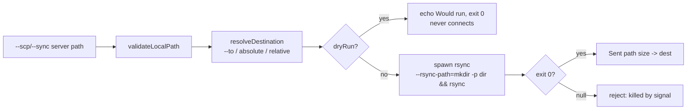

<!--LLM-CONTEXT
Status: ✅ Phases 1-2 done — one rsync executor; --scp is an alias of --sync. Phase 3 closed by deletion
Domain: scp-upload
Gotchas (critical — full list in ## Critical Gotchas below):
  - A spawned ssh inherits no ssh2 timeout — only ConnectTimeout bounds an unreachable host
  - An unread ssh2 channel never emits "close" — still live for ssh/executor.ts
  - A reject: needle that can never appear passes while asserting nothing
  - Tests silently poison the real ~/.ssh/known_hosts without REMOTE_CLI_KNOWN_HOSTS
Related: tasks/ssh/session-lifetime/current.md, tasks/stdin-forwarding/current.md, tasks/stdout-capture/current.md
Last updated: 2026-07-30
-->

# remote-cli — SCP/Sync Upload

## Quick Start (read this first in next session)

**Where we are**: all three phases done. `src/scp/` is deleted — one rsync executor serves both `--sync` and `--scp`, which differ only in a byte count. 40 tests, ~6s.

**Immediate next actions (in order)**:
1. Nothing is in flight. Open items are the two coverage gaps in Next Steps (signal-kill cover, `known_hosts` isolation) — both 🟡/🟢.
2. Before touching upload code, read D6 and D7 below: `--scp` must stay an alias, and `--dry-run` must stay offline.

**Key facts for cold start**:
- `bun test` (40 cases, ~6s) and `bun run typecheck`.
- An absolute local path **requires** `--to`; relative paths still mirror under `appPath`.
- Success = `Sent <path> (<size>) -> user@host:<path>` for a file; a directory omits the size.
- `--dry-run` never connects on either command — it echoes `Would run: …` and returns.

**Gotchas that will trip you**:
- A spawned `ssh` gets no ssh2 timeout; `ConnectTimeout` is the only thing bounding an unreachable host — see G5.
- Any live test must set `REMOTE_CLI_KNOWN_HOSTS` or it corrupts the real `~/.ssh/known_hosts` — see G4.
- A `reject:` needle absent from `src/` passes vacuously — see G6.

---

## Overview

`--scp` shipped in January as a relative-path-only, single-file uploader that refused absolute paths, never implemented its documented `--to`, and hung forever on every real transfer. All three are fixed, every failure is loud, and D6 then collapsed both upload paths into one rsync executor.

Current flow — one connection does mkdir and transfer:

---

## Architecture / Data Model

`resolveDestination(localPath, to, appPath)` in `src/utils/scp-dest.ts` is the single owner of the destination rules, shared by both executors.

| Local path | `--to` | Remote path |
|-----------|--------|-------------|
| Relative | absent | `appPath/<mirrored path>` |
| Relative | relative | `appPath/<to>` (overrides the mirror) |
| Relative | absolute | `<to>` verbatim |
| Absolute | relative | `appPath/<to>` |
| Absolute | absolute | `<to>` verbatim |
| Absolute | **absent** | `LocalPathError` — "Absolute local path needs --to" |

`validatePath` guards the final remote path in every row, so `..` is rejected even in an absolute `--to`.

---

## Files

- `src/sync/executor.ts` — the only upload path: `buildRsyncArgs` relative-vs-explicit branch, `buildMkdirChain()`, `stripRelativeFlag()`, `buildExplicitPaths()`, the `dryRun` early return
- `src/utils/scp-dest.ts` — `resolveDestination()`, `formatBytes()`, `sentSize()`
- `src/cli/parser.ts` — `parseSyncArgs(args, i, singleFile)` serving both spellings, `readFlagValue()`, `isMissingValue()`, `ALL_FLAGS`
- `src/utils/ssh-keepalive.ts` — keepalive constants, `SSH_CONNECT_TIMEOUT_SEC`, `hostKeyOptionsString()` (D5)
- `src/config/paths.ts` — `REMOTE_CLI_CONFIG_DIR` override
- `tests/helpers.ts` — `writeFixtureConfig()`, `writeLiveFixtureConfig()`, `spawnCli()`, `runCli()`, `runCliLive()`, `CliCase`
- `tests/live-sshd.ts` — `startLiveSshd()` / `stopLiveSshd()` / `sshdAvailable()`; generates keys + `sshd_config` into gitignored `tests/fixtures/live/`
- `tests/upload.spec.ts` — 31 offline table-driven cases
- `tests/live-upload.spec.ts` — 9 real-transfer cases

---

## Task Status

| # | Task | Status |
|---|------|--------|
| 1 | Hardening stream: absolute paths, real `--to`, flag validation, hang root-caused, failures made loud | ✅ |
| 2 | Test stream: 31 offline cases + 9 live cases against a throwaway loopback `sshd`, mutation-verified | ✅ |
| 3 | Phase 2: one rsync executor, `--scp` an alias, directories allowed, `src/scp/` deleted | ✅ |
| 4 | Phase 3: surface the real reason a remote `mkdir` failed — closed by deletion, verified (D6 Consequences) | ✅ |
| 5 | Signal-kill rejection cover | ⬜ deferred, diagnosis unresolved |

---

## Key Technical Decisions

### D1 — Absolute local path requires `--to` committed — 2026-07-30

**Problem**
An absolute source has no cwd-relative segment to mirror under `appPath`, so allowing absolute paths forces a choice about where the file lands.

**Decision**
Chosen: hard error naming the flag. Rejected a basename guess (lands the file somewhere plausible-but-wrong and looks like success) and mirroring the full absolute path (junk directories from local paths meaningless remotely).

**Consequences**
`--to` is load-bearing rather than convenience, which makes unknown-flag rejection mandatory — without it a typo'd `--to` triggers the required-flag error on a command that did supply one.

**Status**: committed · **Reversible**: yes

### D2 — Value-slot detection tests ALL flags committed — 2026-07-30

**Problem**
Deciding whether an argv slot holds a value or a forgotten flag. A leading dash cannot be the test, because `--flags "-avz --progress"` legitimately carries a dash-leading value.

**Decision**
Chosen: `isMissingValue()` tests membership against `ALL_FLAGS`. Rejected a per-command set (`--to --exclude` then reads as a destination named `--exclude`) and `value.startsWith("-")` (breaks `--flags`).

**Consequences**
A new flag must join `ALL_FLAGS`, or it becomes swallowable as another flag's value. D6 collapsed the two flag sets into one, so reintroducing a second reopens this.

**Status**: committed · **Reversible**: yes

### D3 — Feature tests only, driving the real CLI committed — 2026-07-30

**Problem**
The riskiest logic (arg construction, destination resolution) lives in non-exported functions.

**Decision**
Chosen: table-driven feature tests spawning the real CLI and asserting on its output — nothing is exported for testing, and `--dry-run`'s echo is the assertion target. Fixture config via `REMOTE_CLI_CONFIG_DIR` with RFC 5737 TEST-NET-1 hosts, so no test can reach a real server; results cached by argv. Rejected unit-testing the builders (exports for tests only) and arg-array snapshots (a typo'd snapshot passes forever).

**Consequences**
Anything requiring a live connection needs the live suite — see Testing.

**Status**: committed · **Reversible**: yes

### D4 — Completion line reports SENT bytes, not confirmed-landed committed — 2026-07-30

**Problem**
The caller needs to verify a transfer without a separate `ls`.

**Decision**
Chosen: print the byte count on exit 0 only, labelled "Sent". A single file gets `Sent <path> (<size>) -> dest`; a directory omits the size, since `statSync` reports the inode size and rsync prints its own totals. Rejected a remote `stat` round-trip — a second connection for a guarantee the exit code already provides.

**Consequences**
The number is what we transmitted, not what landed. The label carries that distinction, so do not reword it to imply verification. Keyed off `singleFile`, not off file-ness, so `--sync` behaviour is unchanged.

**Status**: committed · **Reversible**: yes

### D5 — Quote inside the `-e` string, never at the call site committed — 2026-07-30

**Problem**
Live tests need `UserKnownHostsFile` redirected, and that value reaches rsync's `-e` string, which rsync itself word-splits.

**Decision**
Chosen: `hostKeyOptionsString()` owns the quoting and `hasUnsafeShellChars()` rejects the env var before interpolation. Rejected letting call sites format a shared list (shipped briefly and broke `--sync` on any path with a space) and redirecting `HOME` (does nothing — OpenSSH resolves `~` via `getpwuid()`).

**Consequences**
D6 deleted the argv-shaped `hostKeyOptions()` with `src/scp/`, leaving one shape. Reintroducing a second means keeping two escaping disciplines in step.

**Status**: committed · **Reversible**: yes

### D6 — `--scp` becomes an rsync-backed alias of `--sync` committed — 2026-07-30

**Problem**
`--scp` used two auth stacks for one upload (ssh2 `mkdir -p`, then a spawned `scp`), and that seam is where the hang bug lived.

**Decision**
Chosen: route `--scp` through rsync with `--rsync-path="mkdir -p <dir> && rsync"`, deleting `src/scp/` entirely, and **allow directories** so `--scp` is an alias rather than a second near-identical path. The mkdir target is the destination itself for a directory source, `dirname()` for a file — `dirname()` on a directory destination creates the parent and rsync still fails on the missing leaf.

**Rejected**
- The framing this doc previously carried — that `--rsync-path` was a small shared fix — rests on a false premise: `--sync` never called `ensureRemoteDirectory` at all, so the bug class was `--scp`-only, and `scp` has no `--rsync-path` equivalent.
- Keeping `scp` as a fallback when rsync is missing: preserves Windows support but keeps the bug class alive, so it delivers no simplification. Moot for now — this is a macOS machine.

**Consequences**
rsync is now a hard dependency for single-file uploads. `ScpError` is defined with zero throw sites. Phase 3 (surface the real mkdir-failure reason) is closed by deletion — rsync's own stderr reaches the user through `stdio: "inherit"`, verified as `Permission denied (publickey` on a bad key. G1's subject is gone but the rule stays live for `ssh/executor.ts`.

**Status**: committed · **Reversible**: yes

### D7 — `--dry-run` never connects, on either command committed — 2026-07-30

**Problem**
Routing `--scp` into `executeSync` would have made 13 previously-offline dry-run cases spawn rsync against unroutable fixture hosts, each terminated by a 4s SIGKILL — measured at 20.94s → ~55-73s for the offline suite.

**Decision**
Chosen: `executeSync` echoes `Would run: …` and returns 0 before spawning. `spawnRsync` already printed the command line *before* spawning, so a dry run's entire output is produced client-side and the connection contributed nothing.

**Rejected**
- Keep spawning and absorb the cost: preserves the documented "`--sync --dry-run` connects" wording, but trades a 3.5x slower suite and 13 timeout-terminated tests for a behaviour nobody chose — rsync's `-n` being server-side was an accident of rsync, not a design.
- Early-return on the `--scp` route only: keeps both old gotchas true, but leaves a divergent branch inside the executor, which is the duplication D6 exists to remove.

**Consequences**
Offline suite runs in ~6s, fully offline. `--sync --dry-run` no longer verifies reachability as a side effect; `remote <srv> "true"` covers that. The old gotcha was documented in four places, all corrected.

**Status**: committed · **Reversible**: yes

---

## Bugs Fixed

| Bug | Root cause | Fix |
|-----|-----------|-----|
| Every real `--scp` transfer hung forever, no output, no exit | → see Critical Gotchas G1 | Drain both channels; the code it lived in is now deleted |
| An upload to an unreachable host stalled with no output | → see Critical Gotchas G5 | `-o ConnectTimeout` in `hostKeyOptionsString()` |
| The live suite appended a host key to the real `~/.ssh/known_hosts` on every run | → see Critical Gotchas G4. The suite passed only because of that pollution — every test failed in isolation | `REMOTE_CLI_KNOWN_HOSTS` (D5) |
| Two `reject:` assertions passed while asserting nothing | → see Critical Gotchas G6 | Positive assertions instead |
| A signal-killed transfer reported success | `resolve(code ?? 0)` mapped a `null` close code to exit 0 | Reject naming the signal |
| `Unexpected error:` + raw stack trace on a bad key | `conn.connect()` throws synchronously instead of emitting `error`, escaping an event-only promise executor | try/catch around `connect()`, settling from the catch |
| 4 earlier flag-parsing and hint bugs | `--to` documented but never implemented; a value slot never checked for holding a flag; membership tested against one command's flags only; one mkdir hint for every cause | `readFlagValue()`/`isMissingValue()`/`ALL_FLAGS` (D2) |
| A path with a space silently split into two ssh arguments on `--sync` | The value was interpolated unquoted into the string rsync word-splits for `-e` | `hostKeyOptionsString()` quotes it (D5) |
| A missing `sshd` took 22s to report, blaming the ports | `spawn`'s `ENOENT` is async and never reaches the synchronous poll loop, so it exhausted its whole budget and returned the loop's own failure reason | `existsSync()` the binary before spawning |
| The live suite reported `pass` where sshd was unavailable | Cases asserted a skip reason instead of skipping, so a machine that verified nothing looked identical to one that verified everything | Register via `test.skip` from a pre-flight |

---

## Critical Gotchas

### Library (ssh2)
| Issue | Rule |
|-------|------|
| G1 — An unread channel stream never emits `close` | Scoped to `ssh/executor.ts` since D6 deleted the other call site. Its `stream.on("data", …)` / `stream.stderr.on("data", …)` handlers are load-bearing, not dead code; removing them reopens the hang for `remote <srv> "cmd"`. Preserve-rule in `.claude/agents/code-simplifier.md`. |
| `conn.connect()` throws synchronously | A malformed/unparseable key throws rather than emitting `error`, so an event-only `new Promise` executor lets it escape as a raw stack trace. Wrap it. |
| Neither `readyTimeout` nor keepalive catches a non-settling promise | Both assume the link is the problem. Here the handshake succeeded and the link was healthy — only a `settled` guard plus an explicit deadline bounds it. |

### CLI / transfers
| Issue | Rule |
|-------|------|
| Dropping `-R` is string surgery | `DEFAULT_RSYNC_FLAGS = "-avzR --progress"` fuses `R` into a string, and `--flags` replaces it wholesale — so `stripRelativeFlag()` edits the resolved string rather than skipping a `push()`. |
| rsync nests a directory one level too deep | `src` vs `src/` decides nesting vs contents. Verify with local `rsync -n` between two temp dirs — no SSH needed. |
| `--mkpath` unavailable on macOS | macOS 15+ ships openrsync, not GNU rsync. Chain the mkdir into rsync's remote command via `--rsync-path` instead (`buildMkdirChain()`). |
| G4 — A live test poisons the real `~/.ssh/known_hosts` | The CLI's `StrictHostKeyChecking=accept-new` writes the fixture's per-run host key into the developer's own file, so the next run fails verification. Redirecting `HOME` cannot prevent it — OpenSSH resolves `~` via `getpwuid()`. Set `REMOTE_CLI_KNOWN_HOSTS`; `runCliLive` does. |
| ⚠️ G5 — A spawned `ssh` inherits no ssh2 timeout | `readyTimeout` bounds a handshake, keepalive bounds an *established* session, and neither reaches a spawned binary — so only `-o ConnectTimeout` bounds TCP connect. Without it an unreachable host stalls silently and indefinitely. |
| G6 — A `reject:` needle that can never appear passes while asserting nothing | Verify every `reject:` against `grep -rn "<needle>" src/`; zero hits means the assertion is vacuous. Prefer a positive `expect:` on the correct output. |
| A value interpolated into `-e`'s ssh string splits on spaces | `spawn` passes an argv array through untouched, but **rsync word-splits** the single `-e` string. Quote inside `hostKeyOptionsString()`. |
| A suite reports `pass` for cases that never ran | `bun:test` picks `test` vs `test.skip` at module-eval time, before `beforeAll` can boot a dependency. Decide from a registration-time pre-flight (`sshdAvailable()`), else an unavailable sshd reads as verified. |

> `--dry-run` reachability is now uniform (neither command connects) — see D7.

---

## Testing

`bun test` — 40 cases, ~6s. Offline cases are one row in `tests/upload.spec.ts`'s `CliCase[]` table; live cases go in `tests/live-upload.spec.ts` and get their runner from the `live()` wrapper.

The live suite boots an unprivileged `sshd` on a loopback high port (`tests/live-sshd.ts`), so it needs no server and no admin rights. Where `sshd` is unavailable it reports `skip`, never `pass`.

Verification performed:
- Mutation-tested both suites: reverting 5 earlier bugs turned 3, 2, 1, 1 and 1 offline tests red; removing G1's drain handlers turns the live suite red with a real timeout. Source restored byte-identical each time.
- Every live case also passes in isolation, which is what caught the `known_hosts` pollution — they passed only as a group beforehand.
- The rsync mkdir chain was proven against the live `sshd` before `src/scp/` was deleted: a file into `np/deep/nest` and a directory into `np2/deeper/tree` both landed, nested children included.

---

## Last Session

- Built Phase 2: `src/scp/` deleted, `--scp` routed through `executeSync` as an alias with `singleFile`, directories allowed, mkdir folded into rsync via `--rsync-path`.
- Found the approved plan's blind spot before building: routing `--scp` into `executeSync` would have made 13 offline dry-run cases network-bound at 4s each. `spawnRsync` already echoed client-side, so returning before the spawn was free — suite went 20.94s → ~6s (D7).
- Found and fixed a regression the refactor introduced: a spawned `ssh` inherits no ssh2 timeout, so an unreachable host stalled indefinitely where the ssh2 path had failed in ~1s. `ConnectTimeout` bounds it at 30s (G5).
- Two `reject:` assertions were vacuous — one inherited (`-P ` under rsync), one I wrote while fixing the first (G6).
- An `Explore` agent's inventory was materially wrong (claimed 21 test cases needing rewrite; the real figure was 16 scp cases, 5 needing change). Reading the file settled it before planning off the report.

---

## Next Steps

All three phases of `~/.claude/plans/coverage-gaps-transient-badger.md` are done. What remains:

### Coverage gaps
- [ ] 🟡 Signal-kill rejection has no automated cover, and the diagnosis is open: `spawnRsync`'s `code === null` branch fires for a TERMed child when probed directly, yet killing the real child yielded exit 1 with no signal message across four probe variants. Re-attempt against the rsync implementation.
- [ ] 🟢 `REMOTE_CLI_KNOWN_HOSTS` has no test asserting the real `known_hosts` is untouched by a full `bun test` run — the current case only checks the fixture file gets written.

### Cleanup, optional
- [ ] 🟢 `ScpError` is defined in `src/errors.ts` with zero throw sites. Kept for taxonomy stability; delete if nothing reclaims it.
