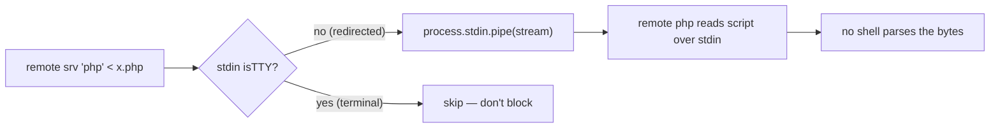

<!--LLM-CONTEXT
Status: ✅ Complete — committed 0d080ca on main (pushed)
Domain: ssh execution
Gotchas:
  - stdin forwarded ONLY when !process.stdin.isTTY — see Critical Gotchas
  - No build step: editing source is live on next `remote` run — see Decisions
Related: tasks/stdout-capture/current.md, tasks/scp-upload/current.md, tasks/ssh/session-lifetime/current.md
Last updated: 2026-06-18
-->

# Stdin Forwarding for Remote Commands

## Quick Start

**State**: Done. `remote <srv> "php" < script.php` works mangle-free. Live on `main` (`0d080ca`, pushed).

1. To run a script on prod with zero shell escaping: `remote "Production" "php" < /tmp/x.php` (or `remote <srv> "cd <path> && php" < x.php`).
2. The fix lives in `src/ssh/executor.ts` — stdin is piped to the SSH channel only when redirected.

**Gotchas**:
- Forwarding is gated on `!process.stdin.isTTY` — interactive terminal commands skip it (so they don't block on EOF).
- No rebuild needed: the `remote` bin imports `index.ts` at runtime; editing source is live next invocation.

**Success**: A multi-line PHP file with `$`/`??`/`{}`/quotes runs on prod and returns correct output, no base64.

---

## Overview

The `remote` CLI (Bun + `ssh2` library) never forwarded local stdin, so feeding a script to a remote interpreter wasn't possible. Multi-line PHP/SQL had to be base64-encoded and decoded server-side to survive shell expansion. This change pipes local stdin into the SSH exec channel, retiring base64 for complex scripts.

---

## Files

- `src/ssh/executor.ts` — `executeCommand()`: pipes `process.stdin` to the exec `stream` when `!isTTY`; `cleanup()` unpipes + pauses stdin.

---

## Critical Gotchas

| Issue | Rule |
|-------|------|
| Unconditional stdin pipe hangs normal commands | Gate on `!process.stdin.isTTY` — a terminal command with no redirect must not wait on stdin EOF. |
| `isTTY` is `true \| undefined`, never `false` | `!process.stdin.isTTY` is the correct guard: `true`→skip, `undefined` (piped)→forward. |
| Double-`end` on the stream | `pipe()` defaults to `{ end: true }`, so it ends the stream on EOF; `cleanup()`'s `unpipe()` removes that internal listener. No manual double-end. |

---

## Key Technical Decisions

| Decision | Rationale |
|----------|-----------|
| Forward stdin only when `!isTTY` | Mirrors how the real `ssh` binary attaches stdin; preserves the interactive/no-redirect path unchanged. |
| `cleanup()` unpipes + pauses stdin | Prevents a piped script from keeping the event loop alive after the remote stream closes. |
| No build/deploy step | `~/.local/bin/remote` trampolines into `index.ts` at runtime — source edits are live next run. |

---

## Next Steps

- [ ] None. Feature complete and pushed.

---

## Last Session (2026-06-18)

- Diagnosed why base64 was needed: `remote` (ssh2 wrapper) never piped local stdin to the remote process.
- Patched `src/ssh/executor.ts` to forward stdin when `!isTTY`; tested live on prod (complex PHP over stdin + a normal command, both pass).
- Reviewed clean (`feature-dev:code-reviewer`). Committed `0d080ca`, pushed to `main`. Docs updated in repo + global CLAUDE.md.
