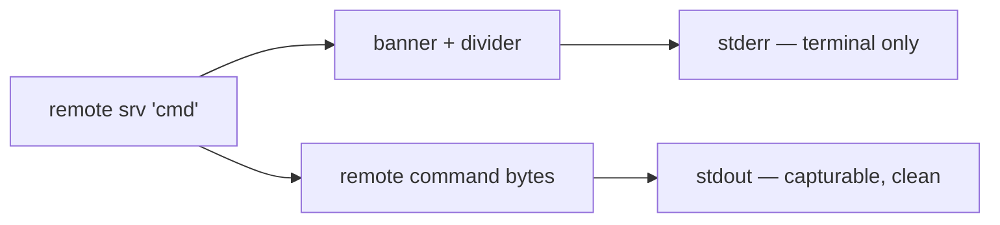

<!--LLM-CONTEXT
Status: ✅ Live — `4a15704` on main (pushed). No deploy step; the `remote` bin imports this checkout at runtime
Domain: ssh execution
Gotchas:
  - `CliResult.output` merges both streams, so a stream test asserting on it proves nothing — see Critical Gotchas
  - A real `--sync`/`--scp` still writes rsync's own chatter to stdout — see Critical Gotchas
Related: tasks/stdin-forwarding/current.md, tasks/scp-upload/current.md, tasks/ssh/session-lifetime/current.md
Last updated: 2026-08-14
-->

# Clean stdout: decoration moved to stderr

## Quick Start

**State**: Live on `main` (`4a15704`, pushed). Editing source here is live on the next `remote` run — no deploy step. Verified on the installed binary: an error path leaves stdout empty, and the 11 live-sshd cases pass (ESC-byte and gzip round-trip included).

1. To capture remote output, just capture it — `VAL=$(remote <srv> "cat /etc/hostname")` returns exactly the file. Binary survives too: `remote <srv> "gzip -c dump.sql" | gunzip`.
2. Decoration lives in `src/ssh/executor.ts` and `src/sync/executor.ts` — all of it `console.error`.

**Gotchas**:
- Three things stay on stdout deliberately: `--dry-run`'s `Would run:`, the `--help`/`--list` screens, and a real transfer's rsync chatter (`stdio: "inherit"`).
- A test asserting on `CliResult.output` cannot detect stream routing — it merges both. Use `.stdout`/`.stderr`.

**Success**: `remote <srv> "echo X" | od -c | grep -c 033` returns `0`, and the banner still appears when run in a terminal.

---

## Overview

`executeCommand()` forwards the remote command's stdout straight to `process.stdout`, but the CLI printed its own banner there first via `console.log`. Every capture therefore carried ANSI escapes plus the banner text, and the corruption was silent at the capture point — it surfaced far away as `Access denied` on a credential that was correct, or `not in gzip format` on a good dump, both reading as failures at the far end rather than in the pipe.

POSIX assigns stdout to "conventional output" and stderr to "diagnostic output"; clig.dev says the same. The banner is diagnostic, so it moved.

---

## Files

- `src/ssh/executor.ts` — `executeCommand()`: banner + divider now `console.error`. The `stream.on("data")` forward to `process.stdout` is unchanged and is what makes stdout the data channel.
- `src/sync/executor.ts` — `executeSync()`: banner, divider and `Sent` to stderr; `spawnRsync()`'s command echo too. `Would run:` deliberately stays on stdout.
- `index.ts` — `handleError()`: the hint joins its error on stderr.
- `tests/helpers.ts` — `CliResult` gained `stdout`/`stderr`; `output` kept as the merged view so existing cases are unaffected.
- `tests/upload.spec.ts` — `describe("stream separation")`, 4 cases.
- `tests/live-upload.spec.ts` — `capture()` helper + 2 live cases asserting raw bytes.

---

## Critical Gotchas

| Issue | Rule |
|-------|------|
| A test asserting on `CliResult.output` passes whichever stream the text used | `output` is `stdout + stderr` merged. Stream-routing cases must read `.stdout`/`.stderr` separately — asserting on the merged view is what let the banner sit on stdout undetected through a whole test suite. |
| `runCli`/`runCliLive` strip ANSI from both streams | A case testing for escape bytes must `spawnSync` with `encoding: "buffer"` itself. See `capture()` in `tests/live-upload.spec.ts`; going through the shared helper would decolour away the thing under test. |
| A real transfer still writes rsync's output to stdout | `spawnRsync` uses `stdio: "inherit"` with `--progress`. That inheritance is also what carries rsync's permission errors to the user, so it stays; the stream rule governs what this CLI prints, not what it spawns. |
| A new test written beside its fix has never been seen to fail | Revert the one line the fix changed, confirm the new test fails and the rest stay green, then restore from a snapshot and `diff`. A test that arrived with its fix is an assumption until its failure is observed. |

---

## Key Technical Decisions

**D-decoration-to-stderr** — *Move all CLI decoration to stderr rather than adding a `--quiet` flag*

**Status**: shipped, 2026-08-14

**Context**: The banner corrupted every stdout capture. Options were a suppression flag, TTY auto-detection, or moving decoration to stderr outright.

**Decision**: Move it. A flag leaves the default broken and requires every caller to know about it; TTY detection makes output differ between a terminal and a pipe, which is harder to reason about and hides the difference at exactly the moment someone is debugging a script. Routing by stream is what POSIX and clig.dev both describe, costs nothing at the call site, and keeps one behaviour everywhere.

**Consequences**: `$(remote …)`, redirects and pipes are clean by default with no flag to remember. Anything that parsed the banner or `Sent` line off stdout breaks — acceptable here, since this is a single-user CLI with no consumers beyond its author. `NO_COLOR` and `--quiet` were considered and left unbuilt; nothing has needed them.

| Decision | Rationale |
|----------|-----------|
| `Would run:` stays on stdout | It is `--dry-run`'s primary output and the offline tests' assertion target, not decoration. |
| `--help`/`--list` stay on stdout | Same reasoning — the screen *is* the command's output. |
| The error hint joins its error on stderr | They were split across streams, so `2>/dev/null` showed an orphaned hint and `>file` injected the hint into captured output. |
| Banner pair left duplicated across the two executors | Two occurrences; the project extracts on the third (CLAUDE.md `{#extract-early}`). Only the divider is byte-identical — the header lines carry different content. |

---

## Next Steps

- [ ] None. Shipped and verified live.

---

## Last Session (2026-08-14)

- Verified a CLAUDE.md claim about the banner: mechanism real, but three specifics wrong (byte count 249 not ~126; no single quote exists, so the asserted quote-injection-to-RCE vector does not; `grep -vE '^\['` fails as a no-op, not by matching nothing).
- Researched the convention across three parallel agents; re-verified POSIX and clig.dev quotes by hand. One agent restated a premise from its own prompt as a finding — direct testing settled it.
- Moved all decoration to stderr, fixed the split error/hint, added stream-separation and raw-byte tests (44 → 46). Confirmed the new test discriminates by reverting the fix and watching exactly one case fail.
- Reviewed clean by `code-reviewer` (0 findings) and `code-simplifier` (no changes needed). `product-reviewer` found the guarantee undiscoverable from `{#usage}` — added a `{#stdout-capture}` section mirroring `{#stdin-pipe}`, and corrected an overclaim in the principle text about rsync's inherited output.
- Shipped `4a15704` to `main`. Verified on the installed binary rather than the test runner: a failed invocation now leaves stdout empty, and 11/11 live-sshd cases pass.
